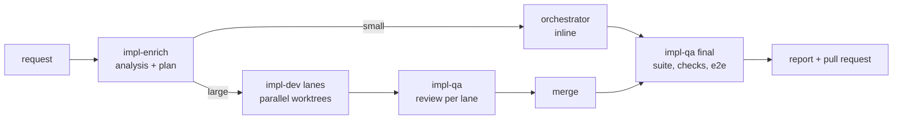

# wh-harness

[](https://github.com/Walter-Dalla/wh-harness/actions/workflows/ci.yml)
[](LICENSE)
[](https://walter-dalla.github.io/wh-harness/)

`wh` is a [Claude Code](https://claude.com/claude-code) plugin that takes a task from a one-line request to a pull request: analysis, plan, parallel implementation in worktrees, code QA, final QA and report.

It works in any repository because it keeps two things apart:

- **Procedures** live in the plugin: skills, subagents and one hook. They never name a project command.
- **Facts** live in your project: build and test commands, ports, docs, limits and glossary, in `.claude/profile/`.

The same `/wh:implementation` drives a .NET + Godot game, a Node API or a Python CLI with no project-specific text in the skill.

**Documentation:** <https://walter-dalla.github.io/wh-harness/> (interactive walkthrough of the flow) · [`docs/MANUAL.md`](docs/MANUAL.md) (full technical manual)

## Contents

- [Requirements](#requirements)
- [Install](#install)
- [Quick start](#quick-start)
- [Commands](#commands)
- [How it works](#how-it-works)
- [Documentation](#documentation)
- [Contributing](#contributing)
- [License](#license)

## Requirements

- [Claude Code](https://claude.com/claude-code)
- `git`, `bash` and `python3`
- Optional, used when installed: [`gh`](https://cli.github.com/) (pull requests), `rtk` (condensed shell output), `codegraph` (code navigation)

## Install

```bash
claude plugin marketplace add Walter-Dalla/wh-harness
claude plugin install wh@wh-harness
```

To offer the plugin to everyone who works on a repository, declare it in that repository's `.claude/settings.json`:

```json
{
  "extraKnownMarketplaces": {
    "wh-harness": { "source": { "source": "github", "repo": "Walter-Dalla/wh-harness" } }
  },
  "enabledPlugins": { "wh@wh-harness": true }
}
```

Update later with `claude plugin update wh@wh-harness`, then open a new session.

## Quick start

In a new Claude Code session at the root of your repository:

```
/wh:adopt
/wh:implementation add CSV export to the reports page
```

`/wh:adopt` diagnoses the repository (`OK` / `MISSING` / `WARN` per piece), writes the profiles in `.claude/profile/` and commits nothing. `/wh:adopt check` only diagnoses. Review the generated profiles, commit `.claude/profile/` and `.claude/settings.json`, and you are set.

## Commands

| Command | What it does |
|---|---|
| `/wh:adopt` | Onboards a repository: `CLAUDE.md`, profiles, glossary, feature map, `context.json`, `settings.json` |
| `/wh:profile` | Writes or completes `.claude/profile/_common.md` and one profile per skill, each fact with its source |
| `/wh:implementation` | A task from request to pull request: analysis, plan, parallel lanes, code QA, final QA, report |
| `/wh:cleanup` | Post-run cleanup: executed plans, open items, stale docs, worktrees |
| `/wh:retro` | Retrospective of a session: candidates to improve the agent's environment, nothing applied |
| `/wh:qa-visual` | Drives the real product against an isolated service, reads screenshots, writes a bug report |
| `/wh:feature-docs` | Keeps a feature map (index + one file per feature) in sync with the code |
| `/wh:start-app`, `/wh:deploy`, `/wh:brainstorm` | Run the app, publish it, generate product ideas, each from its own profile |

The plugin also ships four subagents used by `/wh:implementation` (`wh:impl-structure`, `wh:impl-enrich`, `wh:impl-dev`, `wh:impl-qa`) and `prompt-graph`, a deterministic `UserPromptSubmit` hook (no LLM, no network) that adds pointers from your glossary, feature map and CodeGraph index to each prompt. The hook runs only in a project that has `.claude/profile/context.json`.

## How it works



1. **Enrich.** An architect subagent reads the code and docs, asks you what the code cannot answer, and writes a plan in which every item has files, symbols and an executable acceptance command.
2. **Execute.** Small tasks run inline. Large ones are split into lanes that own disjoint files and run in parallel worktrees.
3. **QA.** A fresh reviewer checks each lane's diff before the merge; a final QA runs the full suite on the integrated branch.
4. **Close.** Retros, a report, updated docs and the pull request. Merging stays with you.

Each skill reads its facts at load time from `.claude/profile/`, and cites a profile section (`profile § Tests`), never a command. Without GitHub the delivery is the branch and the merge command instead of a pull request.

## Documentation

| Where | What |
|---|---|
| [walter-dalla.github.io/wh-harness](https://walter-dalla.github.io/wh-harness/) | Interactive page that walks through the `/wh:implementation` flow, phase by phase (in Portuguese) |
| [`docs/MANUAL.md`](docs/MANUAL.md) | Technical manual: profile injection, the `prompt-graph` hook, onboarding step by step, file formats, debugging, known limits |
| [`plugins/wh/README.md`](plugins/wh/README.md) | The plugin's own short reference |
| [`examples/demo`](examples/demo) | A tiny bakery project with profiles, a glossary and a feature map |
| [`docs/testes/`](docs/testes) | Reports of measured test-drive runs |

## Contributing

Improvements are welcome through pull requests:

1. Fork the repository and create a branch from `main`.
2. Make the change and run the checks: `python3 -m unittest discover -s tests`.
3. Open the pull request against `main`, saying what changed, why, and how you tested it.

For anything larger than a small fix, [open an issue](https://github.com/Walter-Dalla/wh-harness/issues/new/choose) first so the approach can be agreed. The full guide (local setup, the repository's rules, every check CI runs, commit convention) is in [CONTRIBUTING.md](CONTRIBUTING.md).

- [Code of Conduct](CODE_OF_CONDUCT.md)
- [Security policy](SECURITY.md): report vulnerabilities privately, not in a public issue.

## License

[MIT](LICENSE) © Walter Dalla
