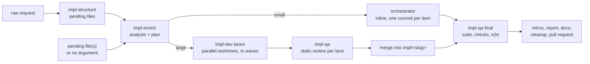
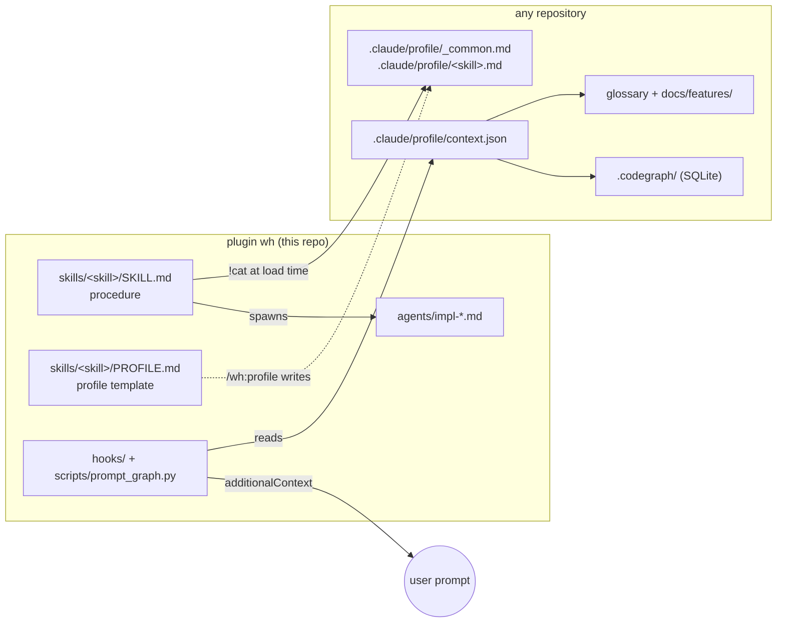

# wh-harness

`wh` is a [Claude Code](https://claude.com/claude-code) plugin that takes a task from a one-line request to a pull request: analysis, plan, parallel implementation in worktrees, code QA, final QA, report. It works in any repository because it separates two things that usually get mixed:

- **Procedures** live in the plugin: skills, subagents and one hook. They never name a project command.
- **Facts** live in the project: build and test commands, ports, docs, limits and glossary, in `.claude/profile/`.

The same `/wh:implementation` drives a .NET + Godot game, a Node API or a Python CLI without one line of project-specific text in the skill.

## Quick start

```
claude plugin marketplace add Walter-Dalla/wh-harness
claude plugin install wh@wh-harness
```

Then, in a new session at the root of your repository:

```
/wh:adopt                                   # diagnoses the repo and writes the profiles
/wh:implementation add CSV export to the reports page
```

`/wh:adopt` is safe to run first: it reports what is missing (`OK` / `MISSING` / `WARN` per piece), creates the profiles, and commits nothing. `/wh:adopt check` only diagnoses.

Requirements: `git`, `bash`, `python3`. Used when installed: `gh` (pull requests), `rtk` (condensed shell output), `codegraph` (code navigation).

## What you get

| Command | What it does |
|---|---|
| `/wh:adopt` | Onboards a repository: map (`CLAUDE.md`), profiles, glossary, feature map, `context.json`, `settings.json` |
| `/wh:profile` | Writes or completes `.claude/profile/_common.md` and one profile per skill, each fact with its source |
| `/wh:implementation` | A task from request to pull request (see below) |
| `/wh:cleanup` | Post-run cleanup: executed plans, open items moved to their home docs, stale docs, worktrees |
| `/wh:retro` | Retrospective of a session: candidates to improve the agent's environment, nothing applied |
| `/wh:qa-visual` | Drives the real product against an isolated service, reads screenshots, writes a bug report |
| `/wh:feature-docs` | Keeps a feature map (index + one file per feature) in sync with the code |
| `/wh:start-app`, `/wh:deploy`, `/wh:brainstorm` | Run the app, publish it, generate product ideas, each from its own profile |

Subagents, spawned by `/wh:implementation`: `wh:impl-structure` (turns a raw request into pending files), `wh:impl-enrich` (architect), `wh:impl-dev` (one lane), `wh:impl-qa` (reviewer).

## How `/wh:implementation` works



1. **Environment.** Clean main branch, remote reachable, profile present (generated if missing).
2. **Enrich.** An architect subagent reads the code and the docs the profile names, writes an analysis with sources per claim, asks the owner what the code cannot answer, then writes a plan in which every item has files, symbols and an executable acceptance command.
3. **Execute.** Small tasks run inline. Large ones are split into lanes that own disjoint files; contract producers run one wave before their consumers. Up to three subagents run at once.
4. **Code QA.** A fresh reviewer checks each lane's diff against the plan's decisions, the repo's rules, the glossary and a risk list, before the merge.
5. **Final QA.** Once, on the integrated branch: full suite, checks, end-to-end QA if the repo has it. It finds and documents; the lane's developer fixes; one retest.
6. **Close.** Every agent writes a retro. The orchestrator consolidates them into a report, updates end-of-task docs, cleans up and opens the pull request. Merging stays with the owner.

It also runs headless (`claude -p "/wh:implementation …"`): with no one to ask, it takes the recommended option for each question and lists those decisions in the report. Without GitHub it delivers the branch and the merge command instead of a pull request.

A measured run, for scale: a 9-item task on a small Python CLI went through 3 lanes in 2 waves, 3 code reviews, a final QA and a retest in 34 minutes for US$ 13 (Opus), and the final QA found 5 real bugs the implementers' tests had missed. Details and gaps found: [`docs/testes/`](docs/testes).

## Why split procedures from facts

Agent instructions rot when they mix "how to work" with "what this repo is". Copying a skill per project means N diverging copies; one global skill means it guesses commands.

| Lives in the plugin (generic) | Lives in the project (facts) |
|---|---|
| the phases of an implementation: enrich, plan, lanes, code QA, final QA, PR, retro | build, test and check commands; disposable service; protected branches |
| cleanup of executed plans and docs | where status, debt and decisions live |
| deploy, start-app, visual QA, feature docs, brainstorm procedures | deploy target, ports, QA harness, feature map |
| the prompt-enrichment hook | glossary, feature map, CodeGraph index |

A skill cites a profile section (`profile § Tests`), never a command. A test (`tests/test_refs.py`) fails when a skill or agent cites a section that the profile template does not have.

## Architecture



### Profile injection

Every skill starts with a pre-processing line that Claude Code runs before the model reads the skill:

```markdown
!`cat .claude/profile/_common.md .claude/profile/implementation.md 2>/dev/null || echo PROFILE_MISSING`
```

If a profile is missing or lacks a section of the template, the skill calls `/wh:profile`. That skill reads the repo (`CLAUDE.md`, CI workflows, build scripts, README), writes one fact per line with its source in brackets (`[ci: tests.yml]`, `[inferido]`), and asks the owner to confirm the inferred lines, one question per profile section. A section with no answer stays `—`, and the phase that depends on it is skipped and reported as skipped.

### `prompt-graph`: deterministic prompt enrichment

A `UserPromptSubmit` hook. No LLM, no network. It matches the prompt against a graph built from the project's own docs and adds **pointers only** to the context:

```
$ python3 plugins/wh/scripts/prompt_graph.py --root examples/demo \
    --query "the showcase shows a sold out croissant but the order still goes through"

[wh:prompt-graph] Deterministic context (glossary + features + CodeGraph); pointers only, verify before asserting.
Avoid "showcase": the term is Shelf (finished goods for sale) (`Shelf`, `ShelfStock`)
Terms: Order = `Order`, `OrderService`
Read: docs/features/stock.md (Pantry, shelf and baking) · docs/features/orders.md (Orders and pickup)
```

With a CodeGraph index present it also lists entry symbols as `file:line`.

- **Nodes:** glossary terms (business name, code name, synonyms to avoid), feature files, code symbols.
- **Edges:** term → feature (index keywords, aliases, mentions), feature ↔ feature (`## Interactions` links), symbol → `file:line` (read-only query on the CodeGraph SQLite index; Godot `class_name` via globs).
- **Matching:** accent and case folding, light plural stemming, greedy longest n-gram first, weights split across the features a key points to.
- **Cost:** rebuilt only when a source changes (mtime signature, atomic write). In a real project with 29 features, 240 terms and 334 symbols: about 0.2 s to rebuild and about 30 ms per prompt with a warm cache, adding 0 to 900 characters. A prompt with no domain words adds nothing.

A project opts in with `.claude/profile/context.json`; without that file the hook does not even start Python. `WH_PROMPT_GRAPH=0` turns it off for a session. See [`examples/demo`](examples/demo).

## Use it in a project

1. Install the plugin (Quick start).
2. Run `/wh:adopt` at the repo root, or by hand: `/wh:profile` generates `.claude/profile/_common.md` and one profile per skill; review the `[inferido]` lines and the `## Limites` section (what no agent may touch).
3. Optional: a glossary, a feature map and `.claude/profile/context.json` turn on `prompt-graph`.
4. Declare the plugin in the project's `.claude/settings.json`, so teammates are offered it when they trust the folder:

   ```json
   {
     "extraKnownMarketplaces": {
       "wh-harness": { "source": { "source": "github", "repo": "Walter-Dalla/wh-harness" } }
     },
     "enabledPlugins": { "wh@wh-harness": true }
   }
   ```

5. Commit `.claude/profile/` and `.claude/settings.json`, and open a new session.

Cost note: the orchestrator runs on the session's model and pays most of the bill; the profile's `§ Models` only chooses the subagents' models. For harness tasks, `claude --model opus` is a sensible default.

## Repository layout

| Path | What |
|---|---|
| `plugins/wh/skills/<skill>/SKILL.md` | the procedure of each skill; `PROFILE.md` beside it is the template of its profile |
| `plugins/wh/skills/implementation/` | `TRIAGE.md` (triage and plan format), `LANES.md` (parallel lanes), `ENVIRONMENT.md` (agent protocol), `REPORT.md` (retros and report), `scripts/preflight.sh`, `scripts/scope.sh` |
| `plugins/wh/skills/adopt/scripts/check.py` | the deterministic onboarding diagnostic |
| `plugins/wh/agents/` | `impl-structure`, `impl-enrich`, `impl-dev`, `impl-qa` |
| `plugins/wh/hooks/`, `plugins/wh/scripts/prompt_graph.py` | the enrichment hook (Python stdlib only) |
| `examples/demo` | a tiny bakery project with profiles, a glossary and a feature map |
| `tests/` | hook, shell scripts, diagnostic and section references |
| [`docs/MANUAL.md`](docs/MANUAL.md) | full technical manual: mechanisms, formats, debugging, known limits |
| [`docs/testes/`](docs/testes) | test-drive reports and the review that followed them |

Skills, profile templates and agents are written in English (since 0.7.0; profiles generated by earlier versions need `/wh:profile` again, because the `##` section names changed). The hook handles glossary and feature docs in both languages: section names in PT or EN, output labels via `"idioma": "en"`.

## Develop the harness

```bash
git clone https://github.com/Walter-Dalla/wh-harness ~/walter-harness
claude plugin marketplace add ~/walter-harness
claude plugin install wh@wh-harness

python3 -m unittest discover -s tests            # stdlib only
claude plugin validate ./plugins/wh --strict     # also run by CI, with the marketplace manifest
claude plugin update wh@wh-harness               # after each edit: the plugin is cached; then open a new session
```

A change to a skill, an agent or the hook bumps `version` in `plugins/wh/.claude-plugin/plugin.json` and updates the manual. CI also runs `bash -n` and `shellcheck` on the scripts.

## Known limits

- The harness depends on Claude Code behavior that is not a documented contract (agent worktrees, their isolation guard, `SendMessage` timing). Each dependency and its fallback is listed in the manual, §8, with the version it was seen on.
- Pull requests need GitHub and an authenticated `gh`; otherwise the branch and the merge command are the delivery.
- `prompt-graph` matches words, not meaning: a paraphrase with no glossary or index word matches nothing.

## Origin

Extracted from the agent setup of KittyCaffee, an idle café game (.NET 10 backend and Godot 4 client) built mostly by Claude Code agents. That repo now keeps only `.claude/profile/`.

## License

MIT
