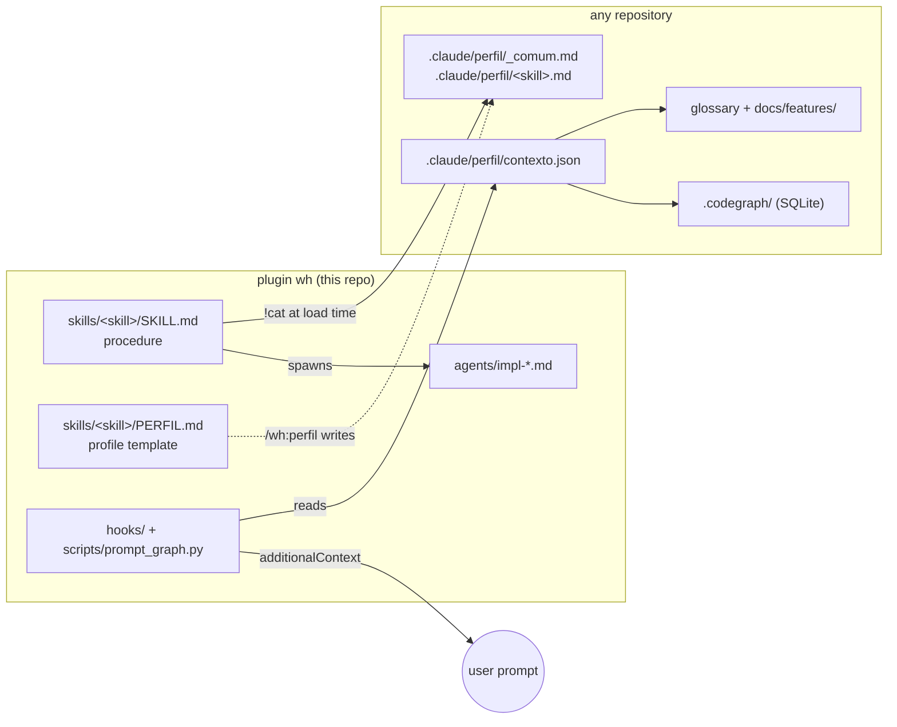

# wh-harness

A generic, modular implementation harness for [Claude Code](https://claude.com/claude-code). One plugin (`wh`) holds the *procedures* — skills, subagents and hooks that work in any repository. Each project holds only its *facts* — commands, ports, docs, limits, glossary — in `.claude/perfil/`. The plugin injects those facts at run time, so the same `/wh:implementation` drives a .NET + Godot game, a Node API or a Python service without one line of project-specific text in the skill.

```
/plugin install wh --marketplace Walter-Dalla/wh-harness
```

## Why

Agent instructions rot when they mix "how to work" with "what this repo is". Copying a skill per project means N diverging copies; one global skill means it guesses commands. This harness splits the two:

| Lives in the plugin (generic) | Lives in the project (facts) |
|---|---|
| the phases of an implementation: enrich, plan, parallel lanes in worktrees, code QA, final QA, PR, retro | build, test and check commands; disposable service; protected branches |
| cleanup of executed plans and docs | where status, debt and decisions live |
| deploy, start-app, visual QA, feature docs, brainstorm procedures | deploy target, ports, QA harness, feature map |
| the prompt-enrichment hook | glossary, feature map, CodeGraph index |

A skill never names a project command; it cites a profile section (`profile § Tests`).

## Architecture



### 1. Profile injection

Every skill starts with a pre-processing line that Claude Code runs before the model reads the skill:

```markdown
!`cat .claude/perfil/_comum.md .claude/perfil/implementation.md 2>/dev/null || echo PERFIL_AUSENTE`
```

If a profile is missing or lacks a section of the template, the skill calls `/wh:perfil`. That skill reads the repo (`CLAUDE.md`, CI workflows, build scripts, README), writes one fact per line with its source in brackets (`[ci: tests.yml]`, `[inferido]`), and asks the owner about every inferred line in a single question.

### 2. `prompt-graph`: deterministic prompt enrichment

A `UserPromptSubmit` hook. No LLM, no network. It matches the prompt against a graph built from the project's own docs and adds **pointers only** to the context:

```
$ python3 plugins/wh/scripts/prompt_graph.py --root examples/demo \
    --query "the showcase shows a sold out croissant but the order still goes through"

[wh:prompt-graph] Deterministic context (glossary + features + CodeGraph); pointers only, verify before asserting.
Avoid "showcase": the term is Shelf (finished goods for sale) (`Shelf`, `ShelfStock`)
Terms: Order = `Order`, `OrderService`
Read: docs/features/stock.md (Pantry, shelf and baking) · docs/features/orders.md (Orders and pickup)
```

With a CodeGraph index present it also lists entry symbols as `file:line` (see the tests for a full sample).

- **Nodes:** glossary terms (business name, code name, synonyms to avoid), feature files, code symbols.
- **Edges:** term → feature (index keywords, aliases, mentions), feature ↔ feature (`## Interactions` links), symbol → `file:line` (read-only query on the CodeGraph SQLite index; Godot `class_name` via globs).
- **Matching:** accent and case folding, light plural stemming, greedy longest n-gram first, weights split across the features a key points to.
- **Cost:** rebuilt only when a source changes (mtime signature, atomic write). In a real project with 29 features, 240 terms and 334 symbols: about 0.2 s to rebuild and about 30 ms per prompt with a warm cache, adding 0 to 900 characters. A prompt with no domain words adds nothing.

A project opts in with `.claude/perfil/contexto.json`. Without that file the hook is silent. See [`examples/demo`](examples/demo).

## What's inside

| Path | What |
|---|---|
| `plugins/wh/skills/implementation` | end-to-end task: enricher subagent writes analysis + plan, small tasks run inline, large ones split into lanes run by `wh:impl-dev` in parallel worktrees, `wh:impl-qa` reviews each lane and runs a final QA, then retros, report and PR |
| `plugins/wh/skills/perfil` | writes or completes a project's profiles from the templates |
| `plugins/wh/skills/limpeza` | post-run cleanup: deletes executed plans, moves open items to their home docs, updates docs that cite changed code |
| `plugins/wh/skills/{deploy,start-app,qa-visual,feature-docs,brainstorm}` | the rest of the lifecycle, each driven by its own profile |
| `plugins/wh/agents` | `impl-enrich`, `impl-dev`, `impl-qa` |
| `plugins/wh/scripts/prompt_graph.py` | the enrichment hook (Python stdlib only) |
| `examples/demo` | a tiny bakery project with a glossary and feature map |
| `tests/` | `python3 -m unittest discover -s tests` |
| [`docs/MANUAL.pt-BR.md`](docs/MANUAL.pt-BR.md) | full technical manual (Portuguese) |

Skills and their templates are written in Portuguese. The hook handles both languages: section names in PT or EN, output labels via `"idioma": "en"`.

## Use it in a project

1. Install the plugin. As a consumer: `claude plugin marketplace add Walter-Dalla/wh-harness`, then `claude plugin install wh@wh-harness`. As a maintainer: `claude plugin marketplace add ~/walter-harness`, so edits take effect in the next session.
2. In the repo, run `/wh:perfil` to generate `.claude/perfil/_comum.md` and one profile per skill, and review the `[inferido]` lines.
3. Optional: add a glossary, a feature map and `.claude/perfil/contexto.json` to turn on `prompt-graph`.
4. Declare the plugin in the project's `.claude/settings.json`, so teammates are offered it when they trust the folder:

   ```json
   {
     "extraKnownMarketplaces": {
       "wh-harness": { "source": { "source": "github", "repo": "Walter-Dalla/wh-harness" } }
     },
     "enabledPlugins": { "wh@wh-harness": true }
   }
   ```

Optional integrations, used when installed: [caveman](https://github.com/JuliusBrussee/caveman) (terse subagent output), `rtk` (condensed shell output) and `codegraph` (code navigation).

## Origin

Extracted from the agent setup of KittyCaffee, an idle café game (.NET 10 backend and Godot 4 client) built mostly by Claude Code agents. That repo now keeps only `.claude/perfil/`.

## License

MIT
